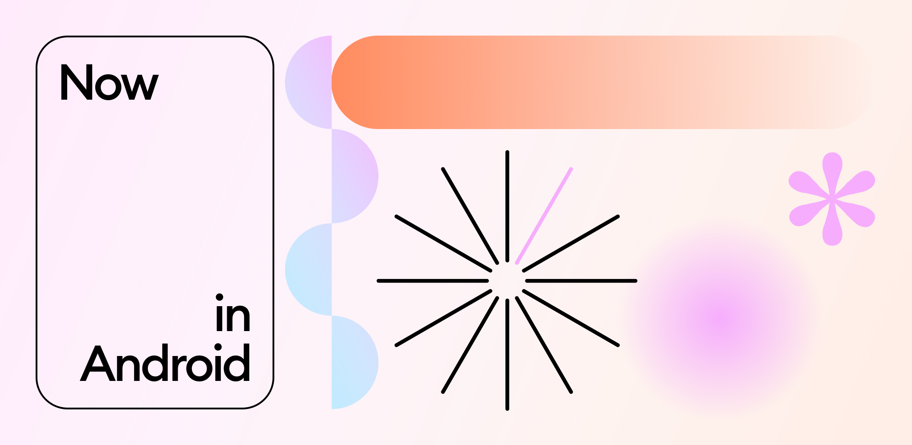
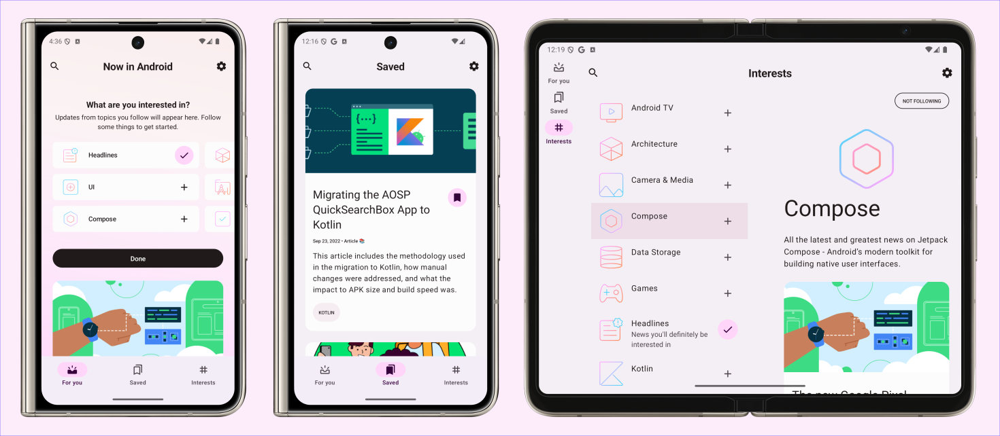

<a href="https://play.google.com/store/apps/details?id=com.childmathematics.apps.android.workschedule"></a>

Now in Android App
==================

**Learn how this app was designed and built in the [design case study](https://goo.gle/nia-figma), [architecture learning journey](docs/ArchitectureLearningJourney.md) and [modularization learning journey](docs/ModularizationLearningJourney.md).**

This is the repository for the [Now in Android](https://developer.android.com/series/now-in-android)
app. It is a **work in progress** 🚧.

**Now in Android** is a fully functional Android app built entirely with Kotlin and Jetpack Compose. It
follows Android design and development best practices and is intended to be a useful reference
for developers. As a running app, it's intended to help developers keep up-to-date with the world
of Android development by providing regular news updates.

The app is currently in development. The `prodRelease` variant is [available on the Play Store](https://play.google.com/store/apps/details?id=com.childmathematics.apps.android.workschedule).

Узнайте, как проектировалось и создавалось это приложение, ознакомившись с 
[описанием процесса проектирования](https://goo.gle/nia-figma), а также с материалами 
по [архитектуре](docs/ArchitectureLearningJourney.md) и 
[модуляризации](docs/ModularizationLearningJourney.md).**

Это репозиторий приложения [Now in Android](https://developer.android.com/series/now-in-android).
Проект находится в стадии активной разработки 🚧.

**Now in Android** — полноценное Android-приложение, полностью написанное на языке Kotlin 
с использованием Jetpack Compose. Оно создано в соответствии с передовыми методами проектирования 
и разработки под Android и служит полезным справочным материалом для разработчиков. 
Приложение помогает быть в курсе событий в мире Android-разработки, предоставляя регулярные 
новостные обновления.

В настоящее время приложение находится в процессе разработки. Версия `prodRelease` 
[доступна в магазине Play Store]
(https://play.google.com/store/apps/details?id=com.childmathematics.apps.android.workschedule).

# Features

**Now in Android** displays content from the
[Now in Android](https://developer.android.com/series/now-in-android) series. Users can browse for
links to recent videos, articles and other content. Users can also follow topics they are interested
in, and be notified when new content is published which matches interests they are following.


# Возможности

В приложении **Now in Android** представлен контент из серии
[Now in Android](https://developer.android.com/series/now-in-android). Пользователи могут находить 
ссылки на свежие видео, статьи и другие материалы. Кроме того, можно подписаться на интересующие 
темы и получать уведомления о публикации новых материалов, соответствующих выбранным интересам.

## Screenshots



## Скриншоты

![Скриншот, на котором показаны экран «Для вас», экран «Интересы» и экран с подробной информацией о теме]
(docs/images/screenshots.png "Скриншот, на котором показаны экран «Для вас», экран «Интересы» и 
экран с подробной информацией о теме")

# Development Environment

**Now in Android** uses the Gradle build system and can be imported directly into Android Studio (make sure you are using the latest stable version available [here](https://developer.android.com/studio)). 

Change the run configuration to `app`.


The `demoDebug` and `demoRelease` build variants can be built and run (the `prod` variants use a backend server which is not currently publicly available).


Once you're up and running, you can refer to the learning journeys below to get a better
understanding of which libraries and tools are being used, the reasoning behind the approaches to
UI, testing, architecture and more, and how all of these different pieces of the project fit
together to create a complete app.

# Среда разработки

В проекте **Now in Android** используется система сборки Gradle; его можно импортировать 
непосредственно в Android Studio (убедитесь, что вы используете последнюю стабильную версию, 
доступную [здесь](https://developer.android.com/studio)).

Установите конфигурацию запуска (run configuration) на `app`.


Вы можете собрать и запустить варианты сборки `demoDebug` и `demoRelease` (варианты `prod` требуют 
подключения к серверной части, которая в данный момент не является общедоступной).


После того как вы настроите проект и запустите его, обратитесь к приведенным ниже материалам для обучения. 
Они помогут вам лучше понять, какие библиотеки и инструменты используются в проекте, почему были выбраны 
те или иные подходы к разработке пользовательского интерфейса (UI), тестированию, архитектуре и 
другим аспектам, а также как все эти компоненты взаимодействуют друг с другом, образуя полноценное приложение.

# Architecture

The **Now in Android** app follows the
[official architecture guidance](https://developer.android.com/topic/architecture) 
and is described in detail in the
[architecture learning journey](docs/ArchitectureLearningJourney.md).

# Архитектура

Приложение **Now in Android** следует
[официальным рекомендациям по архитектуре](https://developer.android.com/topic/architecture),
а подробное описание представлено в
[руководстве по изучению архитектуры](docs/ArchitectureLearningJourney.md).

# Modularization

The **Now in Android** app has been fully modularized and you can find the detailed guidance and
description of the modularization strategy used in
[modularization learning journey](docs/ModularizationLearningJourney.md).

# Модуляризация

Приложение **Now in Android** полностью разбито на модули. Подробное руководство и описание 
стратегии модуляризации, которая была применена, можно найти в разделе 
[«Путь к пониманию модуляризации» (Modularization Learning Journey)](docs/ModularizationLearningJourney.md).

# Build

The app contains the usual `debug` and `release` build variants. 

In addition, the `benchmark` variant of `app` is used to test startup performance and generate a
baseline profile (see below for more information).

`app-nia-catalog` is a standalone app that displays the list of components that are stylized for
**Now in Android**.

The app also uses
[product flavors](https://developer.android.com/studio/build/build-variants#product-flavors) to
control where content for the app should be loaded from.

The `demo` flavor uses static local data to allow immediate building and exploring of the UI.

The `prod` flavor makes real network calls to a backend server, providing up-to-date content. At 
this time, there is not a public backend available.

For normal development use the `demoDebug` variant. For UI performance testing use the
`demoRelease` variant. 

# Построить

Приложение содержит обычные варианты сборки «отладка» и «релиз».

Кроме того, «тестовый» вариант «app» используется для проверки производительности при запуске и создания
базовый профиль (дополнительную информацию см. ниже).

`app-nia-catalog` — это отдельное приложение, отображающее список компонентов, стилизованных под
**Теперь и на Android**.

Приложение также использует
[варианты продукта](https://developer.android.com/studio/build/build-variants#product-flavors), чтобы
контролировать, откуда должен загружаться контент для приложения.

Вариант «демо» использует статические локальные данные, что позволяет немедленно создавать и изучать 
пользовательский интерфейс.

Версия prod выполняет реальные сетевые вызовы к внутреннему серверу, предоставляя актуальный контент. В
на этот раз общедоступный бэкэнд недоступен.

Для нормальной разработки используйте вариант demoDebug. Для тестирования производительности 
пользовательского интерфейса используйте
вариант `demoRelease`.

# Testing

To facilitate testing of components, **Now in Android** uses dependency injection with
[Hilt](https://developer.android.com/training/dependency-injection/hilt-android).

Most data layer components are defined as interfaces.
Then, concrete implementations (with various dependencies) are bound to provide those interfaces to
other components in the app.
In tests, **Now in Android** notably does _not_ use any mocking libraries.
Instead, the production implementations can be replaced with test doubles using Hilt's testing APIs
(or via manual constructor injection for `ViewModel` tests).

These test doubles implement the same interface as the production implementations and generally
provide a simplified (but still realistic) implementation with additional testing hooks.
This results in less brittle tests that may exercise more production code, instead of just verifying
specific calls against mocks.

Examples:
- In instrumentation tests, a temporary folder is used to store the user's preferences, which is
  wiped after each test.
  This allows using the real `DataStore` and exercising all related code, instead of mocking the 
  flow of data updates.

- There are `Test` implementations of each repository, which implement the normal, full repository
  interface and also provide test-only hooks.
  `ViewModel` tests use these `Test` repositories, and thus can use the test-only hooks to
  manipulate the state of the `Test` repository and verify the resulting behavior, instead of
  checking that specific repository methods were called.

To run the tests execute the following gradle tasks: 

- `testDemoDebug` run all local tests against the `demoDebug` variant. Screenshot tests will fail
(see below for explanation). To avoid this, run `recordRoborazziDemoDebug` prior to running unit tests.
- `connectedDemoDebugAndroidTest` run all instrumented tests against the `demoDebug` variant. 

> [!NOTE]
> You should not run `./gradlew test` or `./gradlew connectedAndroidTest` as this will execute 
tests against _all_ build variants which is both unnecessary and will result in failures as only the
`demoDebug` variant is supported. No other variants have any tests (although this might change in future). 

# Тестирование

Для упрощения тестирования компонентов в проекте **Now in Android** используется внедрение зависимостей 
(dependency injection) с помощью библиотеки 
[Hilt](https://developer.android.com/training/dependency-injection/hilt-android).

Большинство компонентов уровня данных (data layer) определены в виде интерфейсов.
Конкретные реализации (имеющие различные зависимости) привязываются к этим интерфейсам, чтобы их можно 
было использовать в других частях приложения.
Примечательно, что в тестах **Now in Android** _не_ используются библиотеки для создания заглушек 
(mocking libraries).
Вместо этого рабочие реализации заменяются на «тестовые дублеры» (test doubles) с помощью инструментов 
тестирования Hilt (или путем ручной передачи зависимостей через конструктор — в тестах для `ViewModel`).

Эти тестовые дублеры реализуют те же интерфейсы, что и основные рабочие компоненты, но представляют 
собой упрощенные (хотя и реалистичные) версии, дополненные специальными механизмами для тестирования.
Благодаря такому подходу тесты становятся более устойчивыми к изменениям и позволяют задействовать 
больше реального кода, а не просто проверять вызовы конкретных методов у объектов-заглушек.

Примеры:
- В инструментальных тестах (instrumentation tests) для хранения пользовательских настроек используется 
 временная папка, которая очищается после каждого теста.
  Это позволяет работать с реальным `DataStore` и проверять весь связанный с ним код, вместо того чтобы
 имитировать поток обновлений данных.

- Для каждого репозитория предусмотрена специальная тестовая реализация (`Test` implementation). 
 Она полностью соответствует интерфейсу основного репозитория, но дополнительно содержит методы, 
 предназначенные исключительно для тестов.
  В тестах для `ViewModel` используются именно такие тестовые реализации репозиториев. Это дает 
 возможность управлять их состоянием и проверять поведение системы, а не просто следить за тем, 
 были ли вызваны те или иные методы репозитория.

Чтобы запустить тесты, выполните следующие задачи Gradle:

- `testDemoDebug` — запуск всех локальных (unit) тестов для варианта сборки `demoDebug`. 
Обратите внимание: тесты скриншотов (screenshot tests) при этом завершатся ошибкой (пояснение см. ниже). 
Чтобы этого избежать, перед запуском unit-тестов выполните команду `recordRoborazziDemoDebug`.
- `connectedDemoDebugAndroidTest` — запуск всех инструментальных тестов (instrumented tests) 
для варианта сборки `demoDebug`. > [!NOTE]
> Не следует запускать `./gradlew test` или `./gradlew connectedAndroidTest`, так как это приведет 
к выполнению тестов для _всех_ вариантов сборки. Это не только излишне, но и вызовет ошибки, поскольку 
поддерживается только вариант `demoDebug`. В других вариантах тесты отсутствуют (хотя в будущем ситуация 
может измениться).

## Screenshot tests
A screenshot test takes a screenshot of a screen or a UI component within the app, and compares it 
with a previously recorded screenshot which is known to be rendered correctly. 

For example, Now in Android has [screenshot tests](https://github.com/android/workschedule/blob/main/app/src/testDemo/kotlin/com/google/samples/apps/workschedule/ui/NiaAppScreenSizesScreenshotTests.kt)
to verify that the navigation is displayed correctly on different screen sizes 
([known correct screenshots](https://github.com/android/workschedule/tree/main/app/src/testDemo/screenshots)). 

Now In Android uses [Roborazzi](https://github.com/takahirom/roborazzi) to run screenshot tests
of certain screens and UI components. When working with screenshot tests the following gradle tasks are useful:

- `verifyRoborazziDemoDebug` run all screenshot tests, verifying the screenshots against the known
correct screenshots.
- `recordRoborazziDemoDebug` record new "known correct" screenshots. Use this command when you have
made changes to the UI and manually verified that they are rendered correctly. Screenshots will be
stored in `modulename/src/test/screenshots`.
- `compareRoborazziDemoDebug` create comparison images between failed tests and the known correct
images. These can also be found in `modulename/src/test/screenshots`. 

> [!NOTE]
> **Note on failing screenshot tests**   
> The known correct screenshots stored in this repository are recorded on CI using Linux. Other
platforms may (and probably will) generate slightly different images, making the screenshot tests fail. 
When working on a non-Linux platform, a workaround to this is to run `recordRoborazziDemoDebug` on the
`main` branch before starting work. After making changes, `verifyRoborazziDemoDebug` will identify only
legitimate changes. 

For more information about screenshot testing 
[check out this talk](https://www.droidcon.com/2023/11/15/easy-screenshot-testing-with-compose/).

## Тестирование с помощью скриншотов
При таком подходе делается снимок экрана или отдельного компонента пользовательского интерфейса (UI) 
в приложении, после чего он сравнивается с эталонным (заранее сохраненным) снимком, который считается 
корректным.

Например, в проекте «Now in Android» предусмотрены [тесты со скриншотами]
(https://github.com/android/workschedule/blob/main/app/src/testDemo/kotlin/com/google/samples/apps/workschedule/ui/NiaAppScreenSizesScreenshotTests.kt), позволяющие проверить, правильно ли отображается навигация на экранах разного размера ([эталонные скриншоты](https://github.com/android/workschedule/tree/main/app/src/testDemo/screenshots)).

В «Now in Android» для выполнения таких тестов используется инструмент [Roborazzi]
(https://github.com/takahirom/roborazzi). При работе с ним полезны следующие задачи Gradle:

- `verifyRoborazziDemoDebug` — запускает все тесты со скриншотами и сравнивает полученные изображения 
с эталонными.
- `recordRoborazziDemoDebug` — сохраняет новые «эталонные» скриншоты. Эту команду следует использовать 
осле внесения изменений в UI, если вы уже вручную убедились, что элементы отображаются корректно. 
Скриншоты будут сохранены в директории `modulename/src/test/screenshots`.
- `compareRoborazziDemoDebug` — создает изображения, на которых наглядно показаны различия между 
результатами теста и эталонными образцами. Эти файлы также можно найти в папке 
`modulename/src/test/screenshots`.

> [!NOTE]
> **Примечание: почему тесты со скриншотами могут не проходить**
> Эталонные скриншоты в этом репозитории были созданы в среде CI (непрерывной интеграции) на базе Linux. 
На других платформах изображения могут (и, скорее всего, будут) немного отличаться, из-за чего тесты 
будут выдавать ошибку. Если вы работаете не в Linux, можно воспользоваться следующим приемом: 
перед началом работы выполните команду `recordRoborazziDemoDebug` в ветке `main`. После внесения 
изменений команда `verifyRoborazziDemoDebug` будет выявлять только действительно значимые (ожидаемые) 
изменения. Чтобы узнать больше о тестировании с помощью скриншотов,
[посмотрите этот доклад](https://www.droidcon.com/2023/11/15/easy-screenshot-testing-with-compose/).

# UI
The app was designed using [Material 3 guidelines](https://m3.material.io/). Learn more about the design process and 
obtain the design files in the [Now in Android Material 3 Case Study](https://goo.gle/nia-figma) (design assets [also available as a PDF](docs/Now-In-Android-Design-File.pdf)).

The Screens and UI elements are built entirely using [Jetpack Compose](https://developer.android.com/jetpack/compose). 

The app has two themes: 

- Dynamic color - uses colors based on the [user's current color theme](https://material.io/blog/announcing-material-you) (if supported)
- Default theme - uses predefined colors when dynamic color is not supported

Each theme also supports dark mode. 

The app uses adaptive layouts to
[support different screen sizes](https://developer.android.com/guide/topics/large-screens/support-different-screen-sizes).

Find out more about the [UI architecture here](docs/ArchitectureLearningJourney.md#ui-layer).

# Пользовательский интерфейс (UI)
Приложение разработано в соответствии с рекомендациями [Material 3](https://m3.material.io/). 
Подробнее о процессе проектирования и доступе к файлам дизайна можно узнать в материале 
[«Now in Android: кейс по Material 3»](https://goo.gle/nia-figma) (файлы дизайна также доступны 
в формате [PDF](docs/Now-In-Android-Design-File.pdf)).

Экраны и элементы интерфейса полностью реализованы с помощью 
[Jetpack Compose](https://developer.android.com/jetpack/compose).

В приложении предусмотрены две темы оформления:

- Динамические цвета (Dynamic color) — используются цвета, основанные на текущей цветовой схеме 
пользователя (если поддерживается системой).
- Стандартная тема — используются заранее заданные цвета (применяется, если динамические цвета 
не поддерживаются).

Для каждой темы предусмотрен темный режим.

Приложение использует адаптивные макеты для [поддержки экранов различных размеров]
(https://developer.android.com/guide/topics/large-screens/support-different-screen-sizes).

Подробнее об [архитектуре пользовательского интерфейса](docs/ArchitectureLearningJourney.md#ui-layer) 
можно узнать здесь.

# Performance

## Benchmarks

Find all tests written using [`Macrobenchmark`](https://developer.android.com/topic/performance/benchmarking/macrobenchmark-overview)
in the `benchmarks` module. This module also contains the test to generate the Baseline profile.

Найдите все тесты, написанные с использованием [`Macrobenchmark`]
(https://developer.android.com/topic/performance/benchmarking/macrobenchmark-overview), 
в модуле `benchmarks`. В этом же модуле находится тест для создания Baseline-профиля.

## Baseline profiles

The baseline profile for this app is located at [`app/src/main/baseline-prof.txt`](app/src/main/baseline-prof.txt).
It contains rules that enable AOT compilation of the critical user path taken during app launch.
For more information on baseline profiles, read [this document](https://developer.android.com/studio/profile/baselineprofiles).

> [!NOTE]
> The baseline profile needs to be re-generated for release builds that touch code which changes app startup.

To generate the baseline profile, select the `benchmark` build variant and run the
`BaselineProfileGenerator` benchmark test on an AOSP Android Emulator.
Then copy the resulting baseline profile from the emulator to [`app/src/main/baseline-prof.txt`](app/src/main/baseline-prof.txt).

## Базовые профили (Baseline Profiles)

Базовый профиль для этого приложения находится по пути [`app/src/main/baseline-prof.txt`]
(app/src/main/baseline-prof.txt).
Он содержит правила, которые позволяют выполнять AOT-компиляцию (предварительную компиляцию) 
критически важных участков кода, задействованных при запуске приложения.
Дополнительные сведения о базовых профилях можно найти в [этом документе]
(https://developer.android.com/studio/profile/baselineprofiles).

> [!NOTE]
> Базовый профиль необходимо создавать заново для релизных сборок, если в них вносятся изменения в код, 
влияющий на запуск приложения.

Чтобы создать базовый профиль, выберите вариант сборки `benchmark` и запустите тест производительности 
`BaselineProfileGenerator` в эмуляторе Android (AOSP).
Затем скопируйте полученный базовый профиль из эмулятора в файл [`app/src/main/baseline-prof.txt`]
(app/src/main/baseline-prof.txt).

## Compose compiler metrics

Run the following command to get and analyze compose compiler metrics:

```bash
./gradlew assembleRelease -PenableComposeCompilerMetrics=true -PenableComposeCompilerReports=true
```

The reports files will be added to [build/compose-reports](build/compose-reports). The metrics files will also be 
added to [build/compose-metrics](build/compose-metrics).

For more information on Compose compiler metrics, see [this blog post](https://medium.com/androiddevelopers/jetpack-compose-stability-explained-79c10db270c8).

## Метрики компилятора Compose

Выполните следующую команду, чтобы получить и проанализировать метрики компилятора Compose:

```bash
./gradlew assembleRelease -PenableComposeCompilerMetrics=true -PenableComposeCompilerReports=true
```

Файлы отчетов будут созданы в директории [build/compose-reports](build/compose-reports). Файлы метрик 
также будут добавлены в директорию [build/compose-metrics](build/compose-metrics).

Дополнительную информацию о метриках компилятора Compose можно найти в [этой статье в блоге]
(https://medium.com/androiddevelopers/jetpack-compose-stability-explained-79c10db270c8).

# License

**Now in Android** is distributed under the terms of the Apache License (Version 2.0). See the
[license](LICENSE) for more information.

# Лицензия

Проект **Now in Android** распространяется на условиях лицензии Apache (версия 2.0). 
Дополнительную информацию см. в файле [лицензии](LICENSE).
