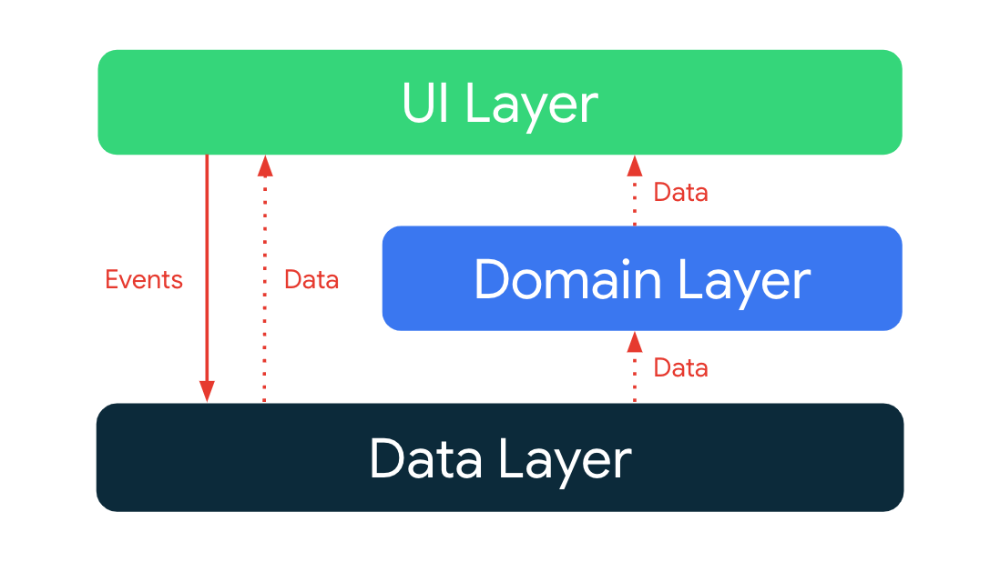
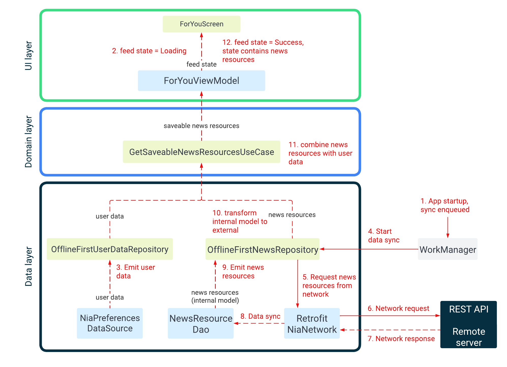
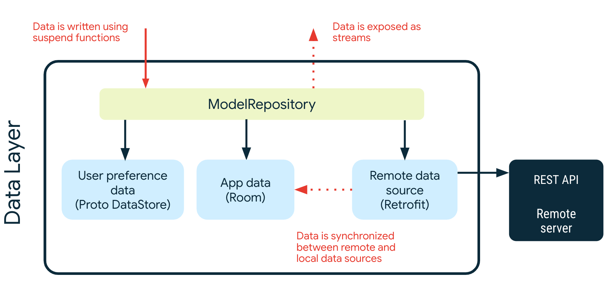
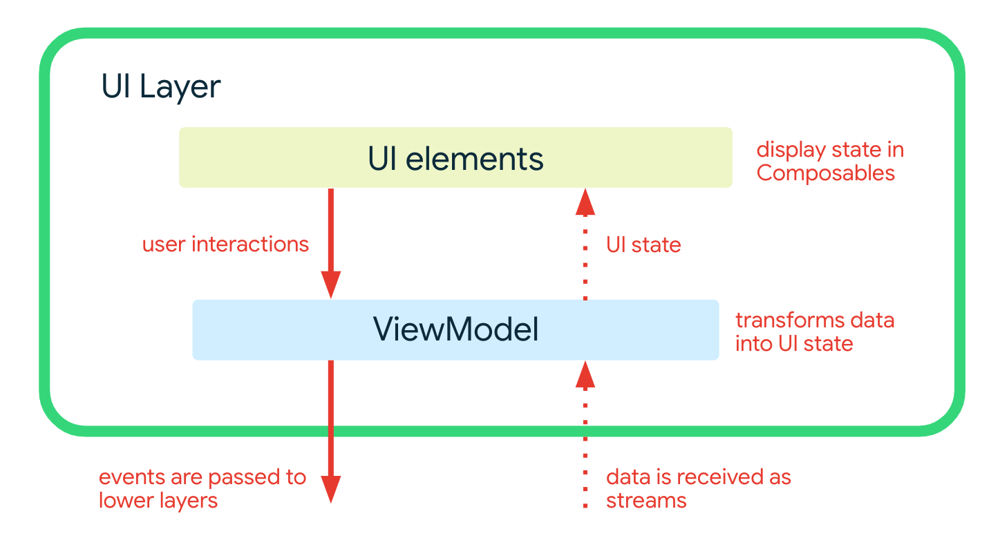

# Architecture Learning Journey

In this learning journey you will learn about the Now in Android app architecture: its layers, key classes and the interactions between them.

 Путь к изучению архитектуры

В рамках этого учебного курса вы познакомитесь с архитектурой приложения «Now in Android»: её уровнями, 
ключевыми классами и взаимодействием между ними.

## Goals and requirements

The goals for the app architecture are:

*   Follow the [official architecture guidance](https://developer.android.com/jetpack/guide) as closely as possible.
*   Easy for developers to understand, nothing too experimental.
*   Support multiple developers working on the same codebase.
*   Facilitate local and instrumented tests, both on the developer’s machine and using Continuous Integration (CI).
*   Minimize build times.

Цели и требования

Цели для архитектуры приложения:

*   Максимально точно следовать [официальному руководству по архитектуре](https://developer.android.com/jetpack/guide).
*   Обеспечить простоту понимания для разработчиков; избегать излишне экспериментальных подходов.
*   Поддерживать совместную работу нескольких разработчиков над одной кодовой базой.
*   Упростить проведение локальных и инструментальных тестов — как на машине разработчика, так и 
в рамках процессов непрерывной интеграции (CI).
*   Минимизировать время сборки.

## Architecture overview

The app architecture has three layers: a [data layer](https://developer.android.com/jetpack/guide/data-layer), a [domain layer](https://developer.android.com/jetpack/guide/domain-layer) and a [UI layer](https://developer.android.com/jetpack/guide/ui-layer).

Обзор архитектуры

Архитектура приложения состоит из трех уровней: 
[уровня данных](https://developer.android.com/jetpack/guide/data-layer), 
[доменного уровня](https://developer.android.com/jetpack/guide/domain-layer) и 
[уровня пользовательского интерфейса](https://developer.android.com/jetpack/guide/ui-layer).

> [!NOTE]  
> The official Android architecture is different from other architectures, such as "Clean Architecture". 
Concepts from other architectures may not apply here, or be applied in different ways. 
[More discussion here](https://github.com/android/workschedule/discussions/1273).
Официальная архитектура Android отличается от других архитектур, например, от «чистой архитектуры» (Clean Architecture).
Концепции из других архитектур могут быть здесь неприменимы или использоваться иначе.
[Подробнее — здесь](https://github.com/android/workschedule/discussions/1273).

The architecture follows a reactive programming model with [unidirectional data flow](https://developer.android.com/jetpack/guide/ui-layer#udf). With the data layer at the bottom, the key concepts are:
Архитектура следует модели реактивного программирования с 
[однонаправленным потоком данных](https://developer.android.com/jetpack/guide/ui-layer#udf). 
В её основе, с уровнем данных в нижней части, лежат следующие ключевые концепции:

*   Higher layers react to changes in lower layers.Верхние уровни реагируют на изменения на нижних уровнях.
*   Events flow down.События передаются вниз.
*   Data flows up.Данные передаются вверх.

The data flow is achieved using streams, implemented using [Kotlin Flows](https://developer.android.com/kotlin/flow).
Поток данных обеспечивается с помощью потоков (streams), 
реализованных на базе [Kotlin Flows](https://developer.android.com/kotlin/flow).

### Example: Displaying news on the For You screen

When the app is first run it will attempt to load a list of news resources from a remote server (when the `prod` build flavor is selected, `demo` builds will use local data). Once loaded, these are shown to the user based on the interests they choose.

The following diagram shows the events which occur and how data flows from the relevant objects to achieve this.

Here's what's happening in each step. The easiest way to find the associated code is to load the project into Android Studio and search for the text in the Code column (handy shortcut: tap <kbd>⇧ SHIFT</kbd> twice).

Пример: отображение новостей на экране «Для вас» (For You)

При первом запуске приложение пытается загрузить список новостных ресурсов с удаленного сервера 
(если выбрана конфигурация сборки `prod`; в сборках `demo` используются локальные данные). 
После загрузки новости отображаются пользователю с учетом выбранных им интересов.

На следующей схеме показаны происходящие события и процесс передачи данных между соответствующими объектами.

![Схема, иллюстрирующая отображение новостных ресурсов на экране «Для вас»]
(images/architecture-2-example.png "Схема, иллюстрирующая отображение новостных ресурсов на экране «Для вас»")

Ниже описано, что происходит на каждом этапе. Чтобы быстро найти соответствующий код, откройте проект 
в Android Studio и выполните поиск по тексту, указанному в столбце «Код» 
(удобное сочетание клавиш: дважды нажмите <kbd>⇧ SHIFT</kbd>).

<table>
  <tr>
   <td><strong>Step</strong>
   </td>
   <td><strong>Description  Описание</strong>
   </td>
   <td><strong>Code </strong>
   </td>
  </tr>
  <tr>
   <td>1
   </td>
   <td>On app startup, a При запуске приложения <a href="https://developer.android.com/topic/libraries/architecture/workmanager">WorkManager</a> job to sync all repositories is enqueued.Задача по синхронизации всех репозиториев поставлена ​​в очередь.
   </td>
   <td><code>Sync.initialize</code>
   </td>
  </tr>
  <tr>
   <td>2
   </td>
   <td>The <code>ForYouViewModel</code> calls <code>GetUserNewsResourcesUseCase</code> to obtain a stream of news resources with their bookmarked/saved state. No items will be emitted into this stream until both the user and news repositories emit an item. While waiting, the feed state is set to Для получения потока новостных ресурсов с указанием их статуса (закладки/сохранение). В этот поток не будут добавляться новые элементы, пока пользователь и новостные хранилища не отправят свои сообщения. Во время ожидания состояние ленты устанавливается на <code>Loading</code>.
   </td>
   <td>Search for usages of <code>NewsFeedUiState.Loading</code>Поиск мест использования <code>NewsFeedUiState.Loading</code>
   </td>
  </tr>
  <tr>
   <td>3
   </td>
   <td>The user data repository obtains a stream of <code>UserData</code> objects from a local data source backed by Proto DataStore.Репозиторий пользовательских данных получает поток объектов <code>UserData</code> из локального источника данных, работающего на базе Proto DataStore.
   </td>
   <td><code>NiaPreferencesDataSource.userData</code>
   </td>
  </tr>
  <tr>
   <td>4
   </td>
   <td>WorkManager executes the sync job which calls <code>OfflineFirstNewsRepository</code> to start synchronizing data with the remote data source.WorkManager выполняет задачу синхронизации, которая обращается к <code>OfflineFirstNewsRepository</code> для запуска процесса синхронизации данных с удаленным источником.
   </td>
   <td><code>SyncWorker.doWork</code>
   </td>
  </tr>
  <tr>
   <td>5
   </td>
   <td><code>OfflineFirstNewsRepository</code> calls <code>RetrofitNiaNetwork</code> to execute the actual API request using <a href="https://square.github.io/retrofit/">Retrofit</a>.<code>OfflineFirstNewsRepository</code> обращается к <code>RetrofitNiaNetwork</code> для выполнения непосредственного API-запроса с использованием <a href="https://square.github.io/retrofit/">Retrofit</a>.
   </td>
   <td><code>OfflineFirstNewsRepository.syncWith</code>
   </td>
  </tr>
  <tr>
   <td>6
   </td>
   <td><code>RetrofitNiaNetwork</code> calls the REST API on the remote server.<code>RetrofitNiaNetwork</code> обращается к REST API на удаленном сервере.
   </td>
   <td><code>RetrofitNiaNetwork.getNewsResources</code>
   </td>
  </tr>
  <tr>
   <td>7
   </td>
   <td><code>RetrofitNiaNetwork</code> receives the network response from the remote server.<code>RetrofitNiaNetwork</code> получает сетевой ответ от удаленного сервера.
   </td>
   <td><code>RetrofitNiaNetwork.getNewsResources</code>
   </td>
  </tr>
  <tr>
   <td>8
   </td>
   <td><code>OfflineFirstNewsRepository</code> syncs the remote data with <code>NewsResourceDao</code> by inserting, updating or deleting data in a local <a href="https://developer.android.com/training/data-storage/room">Room database</a>.<code>OfflineFirstNewsRepository</code> синхронизирует удаленные данные с <code>NewsResourceDao</code>, выполняя вставку, обновление или удаление записей в локальной <a href="https://developer.android.com/training/data-storage/room">базе данных Room</a>.
   </td>
   <td><code>OfflineFirstNewsRepository.syncWith</code>
   </td>
  </tr>
  <tr>
   <td>9
   </td>
   <td>When data changes in <code>NewsResourceDao</code> it is emitted into the news resources data stream (which is a <a href="https://developer.android.com/kotlin/flow">Flow</a>).При изменении данных в <code>NewsResourceDao</code> они передаются в поток данных новостных ресурсов (представляющий собой <a href="https://developer.android.com/kotlin/flow">Flow</a>).
   </td>
   <td><code>NewsResourceDao.getNewsResources</code>
   </td>
  </tr>
  <tr>
   <td>10
   </td>
   <td><code>OfflineFirstNewsRepository</code> acts as an <a href="https://developer.android.com/kotlin/flow#modify">intermediate operator</a> on this stream, transforming the incoming <code>PopulatedNewsResource</code> (a database model, internal to the data layer) to the public <code>NewsResource</code> model which is consumed by other layers.<code>OfflineFirstNewsRepository</code> выступает в роли <a href="https://developer.android.com/kotlin/flow#modify">промежуточного оператора</a> для этого потока, преобразуя входящий объект <code>PopulatedNewsResource</code> (модель базы данных, используемую внутри слоя данных) в общедоступную модель <code>NewsResource</code>, которая затем используется другими слоями.
   </td>
   <td><code>OfflineFirstNewsRepository.getNewsResources</code>
   </td>
  </tr>
  <tr>
   <td>11
   </td>
   <td><code>GetUserNewsResourcesUseCase</code> combines the list of news resources with the user data to emit a list of <code>UserNewsResource</code>s.<code>GetUserNewsResourcesUseCase</code> объединяет список новостных ресурсов с пользовательскими данными для создания списка <code>UserNewsResource</code>.  
   </td>
   <td><code>GetUserNewsResourcesUseCase.invoke</code>
   </td>
  </tr>
  <tr>
   <td>12
   </td>
   <td>When <code>ForYouViewModel</code> receives the saveable news resources it updates the feed state to <code>Success</code>.Когда <code>ForYouViewModel</code> получает новостные ресурсы, которые можно сохранить, он обновляет состояние ленты до <code>Success</code>.

  <code>ForYouScreen</code> then uses the saveable news resources in the state to render the screen.Затем <code>ForYouScreen</code> использует доступные для сохранения новостные ресурсы, находящиеся в состоянии, для отрисовки экрана.
   </td>
   <td>Search for instances of <code>NewsFeedUiState.Success</code>Выполните поиск вхождений <code>NewsFeedUiState.Success</code>
   </td>
  </tr>
</table>

## Data layer

The data layer is implemented as an offline-first source of app data and business logic. It is the source of truth for all data in the app.

Each repository has its own models. For example, the `TopicsRepository` has a `Topic` model and the `NewsRepository` has a `NewsResource` model.

Repositories are the public API for other layers, they provide the _only_ way to access the app data. The repositories typically offer one or more methods for reading and writing data.

Слой данных

Слой данных реализован как источник данных приложения и бизнес-логики, ориентированный на работу 
в автономном режиме (offline-first). Он служит единственным достоверным источником (source of truth) 
для всех данных в приложении.

У каждого репозитория есть свои собственные модели. Например, `TopicsRepository` использует модель `Topic`, 
а `NewsRepository` — модель `NewsResource`.

Репозитории представляют собой публичный API для других слоев; это _единственный_ способ доступа 
к данным приложения. Как правило, репозитории предоставляют один или несколько методов 
для чтения и записи данных.

### Reading data

Data is exposed as data streams. This means each client of the repository must be prepared to react to data changes. Data is not exposed as a snapshot (e.g. `getModel`) because there's no guarantee that it will still be valid by the time it is used.

Reads are performed from local storage as the source of truth, therefore errors are not expected when reading from `Repository` instances. However, errors may occur when trying to reconcile data in local storage with remote sources. For more on error reconciliation, check the data synchronization section below.

_Example: Read a list of topics_

A list of Topics can be obtained by subscribing to `TopicsRepository::getTopics` flow which emits `List<Topic>`.

Whenever the list of topics changes (for example, when a new topic is added), the updated `List<Topic>` is emitted into the stream.

Чтение данных

Данные предоставляются в виде потоков данных. Это означает, что каждый клиент репозитория должен 
быть готов реагировать на изменения данных. Данные не предоставляются в виде моментального снимка 
(например, getModel), поскольку нет гарантии, что они будут действительны к моменту использования.

Чтение осуществляется из локального хранилища как источника истины, поэтому ошибок при чтении 
из экземпляров «Репозитория» не ожидается. Однако могут возникнуть ошибки при попытке согласовать 
данные в локальном хранилище с удаленными источниками. Дополнительную информацию о согласовании 
ошибок см. в разделе синхронизации данных ниже.

_Пример: прочитать список тем_

Список тем можно получить, подписавшись на поток TopicsRepository::getTopics, который генерирует 
List<Topic>.

Всякий раз, когда список тем изменяется (например, при добавлении новой темы), в поток выдается 
обновленный `List<Topic>`.

### Writing data

To write data, the repository provides suspend functions. It is up to the caller to ensure that their execution is suitably scoped.

_Example: Follow a topic_

Simply call `UserDataRepository.toggleFollowedTopicId` with the ID of the topic the user wishes to follow and `followed=true` to indicate that the topic should be followed (use `false` to unfollow a topic).

Запись данных

Для записи данных репозиторий предоставляет функции `suspend`. Ответственность за обеспечение 
надлежащей области видимости (scope) при их выполнении лежит на вызывающей стороне.

_Пример: Подписка на тему_

Просто вызовите `UserDataRepository.toggleFollowedTopicId`, передав идентификатор темы, на которую 
пользователь хочет подписаться, и установив параметр `followed=true` (чтобы отменить подписку, 
используйте `false`).

### Data sources

A repository may depend on one or more data sources. For example, the `OfflineFirstTopicsRepository` depends on the following data sources:

Источники данных

Репозиторий может зависеть от одного или нескольких источников данных. 
Например, `OfflineFirstTopicsRepository` зависит от следующих источников данных:

<table>
  <tr>
   <td><strong>Name</strong>
   </td>
   <td><strong>Backed by При поддержке</strong>
   </td>
   <td><strong>Purpose Цель</strong>
   </td>
  </tr>
  <tr>
   <td>TopicsDao
   </td>
   <td><a href="https://developer.android.com/training/data-storage/room">Room/SQLite</a>
   </td>
   <td>Persistent relational data associated with Topics  Постоянные реляционные данные, связанные с темами
   </td>
  </tr>
  <tr>
   <td>NiaPreferencesDataSource
   </td>
   <td><a href="https://developer.android.com/topic/libraries/architecture/datastore">Proto DataStore</a>
   </td>
   <td>Persistent unstructured data associated with user preferences, specifically which Topics the user is interested in. This is defined and modeled in a .proto file, using the protobuf syntax.Постоянно хранящиеся неструктурированные данные, связанные с предпочтениями пользователя — в частности, с тем, какие темы его интересуют. Эти данные определяются и описываются в файле с расширением .proto с использованием синтаксиса protobuf.
   </td>
  </tr>
  <tr>
   <td>NiaNetworkDataSource
   </td>
   <td>Remote API accessed using Retrofit Удаленный API, к которому осуществляется доступ с помощью Retrofit
   </td>
   <td>Data for topics, provided through REST API endpoints as JSON.Данные по темам, предоставляемые через конечные точки REST API в формате JSON.
   </td>
  </tr>
</table>

### Data synchronization

Repositories are responsible for reconciling data in local storage with remote sources. Once data is obtained from a remote data source it is immediately written to local storage. The  updated data is emitted from local storage (Room) into the relevant data stream and received by any listening clients.

This approach ensures that the read and write concerns of the app are separate and do not interfere with each other.

In the case of errors during data synchronization, an exponential backoff strategy is employed. This is delegated to `WorkManager` via the `SyncWorker`, an implementation of the `Synchronizer` interface.

See the `OfflineFirstNewsRepository.syncWith` for an example of data synchronization.

Синхронизация данных

Репозитории отвечают за приведение данных в локальном хранилище в соответствие с данными из 
удаленных источников. Как только данные получены из удаленного источника, они незамедлительно 
записываются в локальное хранилище. Обновленные данные передаются из локального хранилища (Room) 
в соответствующий поток данных, откуда их получают все подписанные клиенты.

Такой подход позволяет разделить операции чтения и записи в приложении, исключая их взаимное влияние.

В случае возникновения ошибок при синхронизации данных применяется стратегия экспоненциальной 
задержки (exponential backoff). Эта задача делегируется компоненту `WorkManager` 
через `SyncWorker` — реализацию интерфейса `Synchronizer`.

Пример синхронизации данных можно найти в методе `OfflineFirstNewsRepository.syncWith`.

## Domain layer
The [domain layer](https://developer.android.com/topic/architecture/domain-layer) contains use cases. These are classes which have a single invocable method (`operator fun invoke`) containing business logic. 

These use cases are used to simplify and remove duplicate logic from ViewModels. They typically combine and transform data from repositories. 

For example, `GetUserNewsResourcesUseCase` combines a stream (implemented using `Flow`) of `NewsResource`s from a `NewsRepository` with a stream of `UserData` objects from a `UserDataRepository` to create a stream of `UserNewsResource`s. This stream is used by various ViewModels to display news resources on screen with their bookmarked state.  

Notably, the domain layer in Now in Android _does not_ (for now) contain any use cases for event handling. Events are handled by the UI layer calling methods on repositories directly.

Доменный слой
[Доменный слой](https://developer.android.com/topic/architecture/domain-layer) содержит 
варианты использования (use cases). Это классы, в которых есть один вызываемый метод 
(`operator fun invoke`), содержащий бизнес-логику.

Такие варианты использования применяются для упрощения кода и устранения дублирующей логики 
в ViewModel-классах. Как правило, они объединяют и преобразуют данные, поступающие из репозиториев.

Например, `GetUserNewsResourcesUseCase` объединяет поток (реализованный с помощью `Flow`) 
объектов `NewsResource` из `NewsRepository` с потоком объектов `UserData` из `UserDataRepository`, 
формируя на выходе поток объектов `UserNewsResource`. Этот поток используется различными 
ViewModel-классами для отображения новостных ресурсов на экране, включая информацию о том, 
добавлены ли они в закладки.

Стоит отметить, что в проекте «Now in Android» доменный слой (на данный момент) не содержит вариантов 
использования для обработки событий. События обрабатываются на уровне пользовательского 
интерфейса (UI-слое) путем прямого вызова методов репозиториев.

## UI Layer

The [UI layer](https://developer.android.com/topic/architecture/ui-layer) comprises:

*   UI elements built using [Jetpack Compose](https://developer.android.com/jetpack/compose)
*   [Android ViewModels](https://developer.android.com/topic/libraries/architecture/viewmodel)

The ViewModels receive streams of data from use cases and repositories, and transforms them into UI state. The UI elements reflect this state, and provide ways for the user to interact with the app. These interactions are passed as events to the ViewModel where they are processed.

Слой пользовательского интерфейса (UI-слой)

[Слой пользовательского интерфейса](https://developer.android.com/topic/architecture/ui-layer) 
включает в себя:

*   Элементы пользовательского интерфейса, созданные с помощью 
[Jetpack Compose](https://developer.android.com/jetpack/compose)
*   [Android ViewModel](https://developer.android.com/topic/libraries/architecture/viewmodel)

ViewModel получает потоки данных от вариантов использования (use cases) и репозиториев, 
преобразуя их в состояние пользовательского интерфейса (UI state). Элементы интерфейса отображают 
это состояние и предоставляют пользователю возможность взаимодействовать с приложением. 
Эти взаимодействия передаются в ViewModel в виде событий, где они затем обрабатываются.

### Modeling UI state

UI state is modeled as a sealed hierarchy using interfaces and immutable data classes. State objects are only ever emitted through the transform of data streams. This approach ensures that:

*   the UI state always represents the underlying app data - the app data is the source-of-truth.
*   the UI elements handle all possible states.

**Example: News feed on For You screen**

The feed (a list) of news resources on the For You screen is modeled using `NewsFeedUiState`. This is a sealed interface which creates a hierarchy of two possible states:

*   `Loading` indicates that the data is loading
*   `Success` indicates that the data was loaded successfully. The Success state contains the list of news resources.

The `feedState` is passed to the `ForYouScreen` composable, which handles both of these states.

Моделирование состояния пользовательского интерфейса (UI)

Состояние UI моделируется как «запечатанная» (sealed) иерархия с использованием интерфейсов и неизменяемых 
(immutable) классов данных. Объекты состояния передаются исключительно посредством преобразования 
потоков данных. Такой подход гарантирует, что:

*   состояние UI всегда отражает актуальные данные приложения — данные приложения являются 
первоисточником истины (source-of-truth).
*   элементы UI учитывают все возможные состояния.

**Пример: лента новостей на экране «Для вас» (For You)**

Лента (список) новостных материалов на экране «Для вас» моделируется с помощью `NewsFeedUiState`. 
Это «запечатанный» интерфейс (sealed interface), который формирует иерархию из двух возможных состояний:

*   `Loading` — данные загружаются.
*   `Success` — данные успешно загружены. Состояние `Success` содержит список новостных материалов.

Объект `feedState` передается в компонуемую функцию (composable) `ForYouScreen`, которая обрабатывает 
оба этих состояния.

### Transforming streams into UI state

ViewModels receive streams of data as cold [flows](https://kotlin.github.io/kotlinx.coroutines/kotlinx-coroutines-core/kotlinx.coroutines.flow/-flow/index.html) from one or more use cases or repositories. These are [combined](https://kotlin.github.io/kotlinx.coroutines/kotlinx-coroutines-core/kotlinx.coroutines.flow/combine.html) together, or simply [mapped](https://kotlinlang.org/api/kotlinx.coroutines/kotlinx-coroutines-core/kotlinx.coroutines.flow/map.html), to produce a single flow of UI state. This single flow is then converted to a hot flow using [stateIn](https://kotlin.github.io/kotlinx.coroutines/kotlinx-coroutines-core/kotlinx.coroutines.flow/state-in.html). The conversion to a state flow enables UI elements to read the last known state from the flow.

**Example: Displaying followed topics**

The `InterestsViewModel` exposes `uiState` as a `StateFlow<InterestsUiState>`. This hot flow is created by obtaining the cold flow of `List<FollowableTopic>` provided by `GetFollowableTopicsUseCase`. Each time a new list is emitted, it is converted into an `InterestsUiState.Interests` state which is exposed to the UI.

Преобразование потоков данных в состояние пользовательского интерфейса (UI)

ViewModels получают потоки данных в виде «холодных» 
[потоков (flows)](https://kotlin.github.io/kotlinx.coroutines/kotlinx-coroutines-core/kotlinx.coroutines.flow/-flow/index.html) из одного или нескольких вариантов использования (use cases) или репозиториев. Эти потоки [объединяются (combine)](https://kotlin.github.io/kotlinx.coroutines/kotlinx-coroutines-core/kotlinx.coroutines.flow/combine.html) или просто [преобразуются (map)](https://kotlinlang.org/api/kotlinx.coroutines/kotlinx-coroutines-core/kotlinx.coroutines.flow/map.html) в единый поток состояния пользовательского интерфейса. Затем этот поток преобразуется в «горячий» поток с помощью функции [stateIn](https://kotlin.github.io/kotlinx.coroutines/kotlinx-coroutines-core/kotlinx.coroutines.flow/state-in.html). Такое преобразование позволяет элементам пользовательского интерфейса считывать из потока последнее известное состояние.

**Пример: отображение тем, на которые подписан пользователь**

Класс `InterestsViewModel` предоставляет доступ к `uiState` в виде `StateFlow<InterestsUiState>`. 
Этот «горячий» поток создается на основе «холодного» потока данных `List<FollowableTopic>`, 
который поступает из `GetFollowableTopicsUseCase`. При каждом появлении нового списка данных 
он преобразуется в состояние `InterestsUiState.Interests`, которое становится доступным 
для пользовательского интерфейса.

### Processing user interactions

User actions are communicated from UI elements to ViewModels using regular method invocations. These methods are passed to the UI elements as lambda expressions.

**Example: Following a topic**

The `InterestsScreen` takes a lambda expression named `followTopic` which is supplied from `InterestsViewModel.followTopic`. Each time the user taps on a topic to follow this method is called. The ViewModel then processes this action by informing the user data repository.

Обработка взаимодействий с пользователем

Действия пользователя передаются от элементов пользовательского интерфейса (UI) к объектам ViewModel 
посредством обычных вызовов методов. Эти методы передаются в UI-элементы в виде лямбда-выражений.

**Пример: подписка на тему**

Компонент `InterestsScreen` принимает лямбда-выражение `followTopic`, которое предоставляется 
методом `InterestsViewModel.followTopic`. Каждый раз, когда пользователь нажимает на тему, 
чтобы подписаться на неё, вызывается этот метод. Затем ViewModel обрабатывает данное действие, 
уведомляя репозиторий пользовательских данных.

## Further reading

[Guide to app architecture](https://developer.android.com/topic/architecture)

[Jetpack Compose](https://developer.android.com/jetpack/compose)
