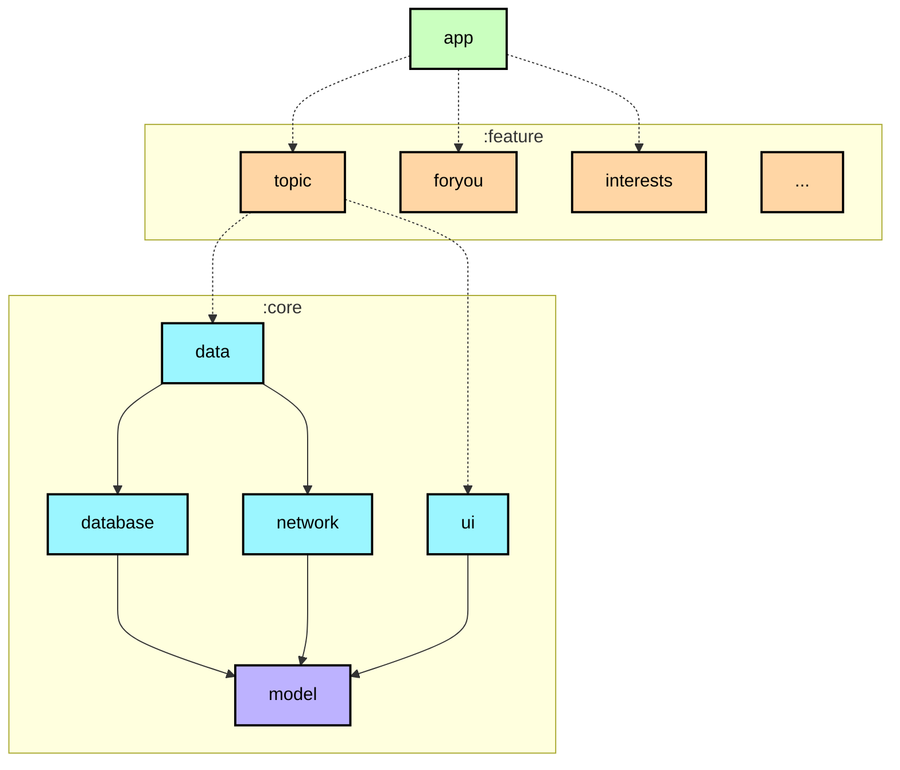
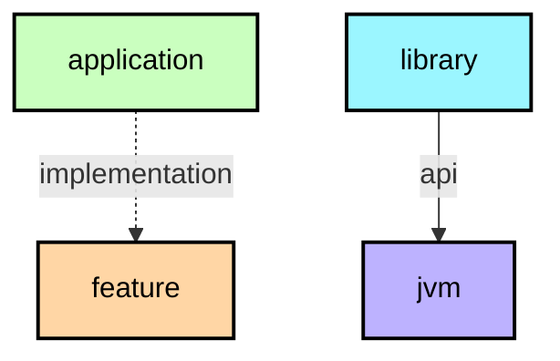

# Modularization learning journey

In this learning journey you will learn about the modularization strategy used
to create modules in the Now in Android app. For the theory behind modularization, check out
[the official guidance](https://developer.android.com/topic/modularization).

**IMPORTANT:** Every module has a dependency graph in its README ([example for the app module](https://github.com/android/workschedule/tree/main/app)) which can be useful for understanding the overall structure of the project.

Путь обучения: модулизация

В рамках этого учебного курса вы познакомитесь со стратегией модулизации, которая применяется 
для создания модулей в приложении «Now in Android». Теоретические основы модулизации можно 
изучить в [официальном руководстве](https://developer.android.com/topic/modularization).

**ВАЖНО:** Для каждого модуля в его файле README приведен граф зависимостей 
(см. [пример для модуля «app»](https://github.com/android/workschedule/tree/main/app)), 
который поможет лучше понять общую структуру проекта.

## Module types

📋 Graph legend

**Top tip**: A module graph (shown above) can be useful during modularization planning for
visualizing dependencies between modules.

The Now in Android app contains the following types of modules:
**Полезный совет**: Граф модулей (показанный выше) может пригодиться при планировании 
модулизации — он помогает визуализировать зависимости между модулями.

В приложении «Now in Android» представлены следующие типы модулей:
### The `app` module
This contains app level and scaffolding classes that bind the rest of the codebase, such as
`MainActivity`, `NiaApp` and app-level controlled navigation. A good example of this is the navigation setup through `NiaNavHost` and the bottom navigation bar setup through `TopLevelDestination`. The `app` module depends on all `feature` modules and required `core` modules.
Здесь содержатся классы уровня приложения и вспомогательные структуры (scaffolding), которые 
связывают воедино остальную часть кодовой базы — например, `MainActivity`, `NiaApp` и механизмы 
навигации на уровне приложения. Наглядным примером служит настройка навигации с помощью `NiaNavHost` 
и конфигурация нижней панели навигации через `TopLevelDestination`. Модуль `app` зависит от всех 
модулей `feature`, а также от необходимых модулей `core`.

### Feature modules 
These are feature-specific modules that handle a single responsibility in the app. For example, the `ForYou` feature handles all content and UI state for the "ForYou" screen. Feature modules aren't Gradle modules themselves, they are split into two submodules: 

* `api` - contains navigation keys
* `impl` - contains everything else

This approach allows features to navigate to other features by using the target feature's navigation keys. A feature's `api` and `impl` modules can be used by any app, including test or other flavoured apps. If a class is needed only by one feature module, it should remain within that module. If not, it should be placed into an appropriate `core` module. 

A feature's `api` module should not depend on another feature's `api` or `impl` module. A feature's `impl` should only depend on another feature's `api` module. Both submodules should only depend on the `core` modules that they require. 

Это модули, ориентированные на конкретные функциональные возможности (фичи) и отвечающие за выполнение 
одной задачи в приложении. Например, фича `ForYou` управляет всем контентом и 
состоянием пользовательского интерфейса (UI) для экрана «ForYou». Сами по себе такие фичи 
не являются отдельными модулями Gradle; каждая из них разделена на два подмодуля:

* `api` — содержит ключи для навигации;
* `impl` — содержит всё остальное.

Такой подход позволяет одной фиче переходить к другой, используя ключи навигации целевой фичи. 
Модули `api` и `impl` могут быть использованы в любом приложении — например, в тестовых сборках 
или других вариациях (флейворах) приложения. Если какой-то класс нужен только одной фиче, 
он должен оставаться внутри её модуля. В противном случае его следует перенести в соответствующий 
модуль `core`.

Модуль `api` одной фичи не должен зависеть от модулей `api` или `impl` другой фичи. 
Модуль `impl` может зависеть только от модуля `api` другой фичи. Оба подмодуля могут зависеть 
только от тех модулей `core`, которые им необходимы.

### Core modules 
These are common library modules containing auxiliary code and specific dependencies that
  need to be shared between other modules in the app. These modules can depend on other core
  modules, but they shouldn’t depend on feature nor app modules.

Это общие библиотечные модули, содержащие вспомогательный код и специфические зависимости, 
которые должны быть доступны другим модулям приложения. Такие модули могут зависеть от других 
базовых модулей, но они не должны зависеть от модулей функциональных возможностей (feature-модулей) 
или модулей самого приложения (app-модулей).

### Miscellaneous modules
For example, `sync`, `benchmark` and `test` modules, as well as `app-nia-catalog` - a catalog app for displaying our design system quickly.
Например, модули `sync`, `benchmark` и `test`, 
а также `app-nia-catalog` — приложение-каталог для быстрого отображения нашей дизайн-системы.
## Examples

<table>
  <tr>
   <td><strong>Name название</strong>
   </td>
   <td><strong>Responsibilities Обязанности</strong>
   </td>
   <td><strong>Key classes and good examples Ключевые классы и удачные примеры</strong>
   </td>
  </tr>
  <tr>
   <td><code>app</code>
   </td>
   <td>Brings everything together required for the app to function correctly. This includes UI scaffolding and navigation. Объединяет всё необходимое для корректной работы приложения. Сюда входят каркас пользовательского интерфейса и навигация.
   </td>
   <td><code>NiaApp, MainActivity</code> 
   App-level controlled navigation via <code>NiaNavHost, NiaAppState, TopLevelDestination</code> Навигация на уровне приложения управляется с помощью <code>NiaNavHost, NiaAppState, TopLevelDestination</code>
   </td>
  </tr>
  <tr>
   <td><code>feature:1:api,</code> 
   <code>feature:2:api</code> 
   ...
   </td>
   <td>Navigation keys and functions that other features can use to navigate to this feature.  
   For example: The <code>:topic:api</code> module exposes a <code>Navigator.navigateToTopic</code> function that the
   <code>:interests:impl</code> module uses to navigate from the <code>InterestsScreen</code> to the <code>TopicScreen</code> when
   a topic is clicked. 
    Клавиши навигации и функции, которые могут использоваться другими компонентами для перехода к данному функциональному элементу.  
    Например: модуль <code>:topic:api</code> предоставляет функцию <code>Navigator.navigateToTopic</code>, которую модуль <code>:interests:impl</code> использует для перехода с экрана <code>InterestsScreen</code> на экран <code>TopicScreen</code> при нажатии на тему.
   </td>
   <td><code>TopicNavKey</code>
   </td>
  </tr>
  <tr>
   <td><code>feature:1:impl,</code> 
   <code>feature:2:impl</code> 
   ...
   </td>
   <td>Functionality associated with a specific feature or user journey. Typically contains UI components and ViewModels which read data from other modules. 
   Examples include:  Функциональность, связанная с конкретной возможностью или пользовательским сценарием. Обычно включает компоненты пользовательского интерфейса (UI) и ViewModel, которые считывают данные из других модулей. 
Примеры: 
   <ul>
      <li><a href="https://github.com/android/workschedule/tree/main/feature/topic/impl"><code>feature:topic:impl</code></a> displays information about a topic on the TopicScreen.<code>feature:topic:impl</code></a> отображает информацию о теме на экране TopicScreen.</li>
      <li><a href="https://github.com/android/workschedule/tree/main/feature/foryou/impl"><code>feature:foryou:impl</code></a> which displays the user's news feed, and onboarding during first run, on the For You screen.<code>feature:foryou:impl</code></a>, который отображает ленту новостей пользователя, а также процесс ознакомления (онбординг) при первом запуске на экране «Для вас» (For You).</li>
      </ul>
   </td>
   <td><code>TopicScreen</code> 
   <code>TopicViewModel</code>
   </td>
  </tr>
  <tr>
   <td><code>core:data</code>
   </td>
   <td>Fetching app data from multiple sources, shared by different features.Получение данных приложения из нескольких источников, используемых различными функциональными компонентами.
   </td>
   <td><code>TopicsRepository</code> 
   </td>
  </tr>
  <tr>
   <td><code>core:designsystem</code>
   </td>
   <td>Design system which includes Core UI components (many of which are customized Material 3 components), app theme and icons. The design system can be viewed by running the <code>app-nia-catalog</code> run configuration.Система дизайна, включающая базовые компоненты пользовательского интерфейса (многие из которых представляют собой модифицированные компоненты Material 3), тему приложения и значки. Ознакомиться с системой дизайна можно, запустив конфигурацию <code>app-nia-catalog</code>. 
   </td>
   <td>
   <code>NiaIcons</code>    <code>NiaButton</code>    <code>NiaTheme</code> 
   </td>
  </tr>
  <tr>
   <td><code>core:ui</code>
   </td>
   <td>Composite UI components and resources used by feature modules, such as the news feed. Unlike the <code>designsystem</code> module, it is dependent on the data layer since it renders models, like news resources.Композитные компоненты пользовательского интерфейса и ресурсы, используемые функциональными модулями — например, лентой новостей. В отличие от модуля <code>designsystem</code>, этот модуль зависит от слоя данных, поскольку он выполняет отрисовку моделей (например, новостных материалов). 
   </td>
   <td> <code>NewsFeed</code> <code>NewsResourceCardExpanded</code>
   </td>
  </tr>
  <tr>
   <td><code>core:common</code>
   </td>
   <td>Common classes shared between modules.Общие классы, используемые в разных модулях.
   </td>
   <td><code>NiaDispatchers</code> 
   <code>Result</code>
   </td>
  </tr>
  <tr>
   <td><code>core:network</code>
   </td>
   <td>Making network requests and handling responses from a remote data source.Выполнение сетевых запросов и обработка ответов от удаленного источника данных.
   </td>
   <td><code>RetrofitNiaNetworkApi</code>
   </td>
  </tr>
  <tr>
   <td><code>core:testing</code>
   </td>
   <td>Testing dependencies, repositories and util classes.Тестирование зависимостей, репозиториев и вспомогательных классов.
   </td>
   <td><code>NiaTestRunner</code> 
   <code>TestDispatcherRule</code>
   </td>
  </tr>
  <tr>
   <td><code>core:datastore</code>
   </td>
   <td>Storing persistent data using DataStore.Сохранение постоянных данных с помощью DataStore.
   </td>
   <td><code>NiaPreferences</code> 
   <code>UserPreferencesSerializer</code>
   </td>
  </tr>
  <tr>
   <td><code>core:database</code>
   </td>
   <td>Local database storage using Room.Локальное хранение данных в базе данных с использованием Room.
   </td>
   <td><code>NiaDatabase</code> 
   <code>DatabaseMigrations</code> 
   <code>Dao</code> classes
   </td>
  </tr>
  <tr>
   <td><code>core:model</code>
   </td>
   <td>Model classes used throughout the app.Классы моделей, используемые во всём приложении.
   </td>
   <td><code>Topic</code> 
   <code>Episode</code> 
   <code>NewsResource</code>
   </td>
  </tr>
</table>

## Dependency graphs
Each module has its own `README.md` file containing a module graph (e.g. [`:app` module graph](../app/README.md#module-dependency-graph)).  
When modules dependencies change, module graphs are automatically updated by the [Build.yaml](../.github/workflows/Build.yaml) workflow.  
You can also manually update the graphs by running the `graphUpdate` task.
Каждый модуль имеет свой собственный файл `README.md`, содержащий граф модуля 
(например, [`:app` граф модуля](../app/README.md#module-dependent-graph)).
При изменении зависимостей модулей графы модулей автоматически обновляются с помощью 
рабочего процесса [Build.yaml](../.github/workflows/Build.yaml).
Вы также можете обновить графики вручную, запустив задачу «graphUpdate».

## Further considerations

Our modularization approach was defined taking into account the “Now in Android” project roadmap, upcoming work and new features. Additionally, our aim this time around was to find the right balance between overmodularizing a relatively small app and using this opportunity to showcase a modularization pattern fit for a much larger codebase, closer to real world apps in production environments.

This approach was discussed with the Android community, and evolved taking their feedback into account. With modularization however, there isn’t one right answer that makes all others wrong. Ultimately, there are many ways and approaches to modularizing an app and rarely does one approach fit all purposes, codebases and team preferences. This is why planning beforehand and taking into account all goals, problems you’re trying to solve, future work and predicting potential stepping stones are all crucial steps for defining the best fit structure under your own, unique circumstances. Developers can benefit from a brainstorming session to draw out a graph of modules and dependencies to visualize and plan this better.

Our approach is such an example - we don’t expect it to be an unchangeable structure applicable to all cases, and in fact, it could evolve and change in the future. It’s a general guideline we found to be the best fit for our project and offer it as one example you can further modify, expand and build on top of. One way of doing this would be to increase the granularity of the codebase even more. Granularity is the extent to which your codebase is composed of modules. If your data layer is small, it’s fine to keep it in a single module. But once the number of repositories and data sources starts to grow, it might be worth considering splitting them into separate modules.

We are also always open to your constructive feedback - learning from the community and exchanging ideas is one of the key elements to improving our guidance.

Дополнительные соображения

При разработке нашего подхода к модулизации мы учитывали дорожную карту проекта «Now in Android», 
предстоящие задачи и новые функциональные возможности. Кроме того, мы стремились найти оптимальный 
баланс: не перегружать модулями относительно небольшое приложение, но при этом продемонстрировать 
подход, подходящий для гораздо более крупных кодовых баз — таких, с которыми разработчики 
сталкиваются в реальных проектах.

Этот подход обсуждался с Android-сообществом, и мы дорабатывали его с учетом полученных отзывов. 
В вопросах модулизации не существует единственно верного решения, которое делало бы все остальные 
варианты ошибочными. Напротив, существует множество способов разделения приложения на модули, и 
редко какой-то один подход универсально подходит для любых целей, кодовых баз или предпочтений команды. 
Именно поэтому так важно заранее все спланировать: учесть поставленные цели, проблемы, которые 
вы хотите решить, планы на будущее и возможные трудности. Это поможет определить структуру, которая 
лучше всего подойдет именно для ваших условий. Полезным шагом может стать совместное обсуждение 
(мозговой штурм), в ходе которого можно составить схему модулей и зависимостей — это позволит 
наглядно представить структуру и спланировать ее более эффективно.

Наш подход — лишь один из примеров. Мы не рассматриваем его как нечто неизменное, подходящее для 
любого случая; напротив, со временем он может развиваться и меняться. Это общее руководство, 
которое оказалось наиболее подходящим для нашего проекта. Мы предлагаем его как вариант, который вы 
можете дорабатывать, расширять и использовать в качестве основы для собственных решений. Например, 
можно еще сильнее увеличить гранулярность кодовой базы. Под гранулярностью здесь понимается степень 
дробления кодовой базы на модули. Если слой данных (data layer) небольшой, его вполне можно оставить 
в рамках одного модуля. Однако по мере роста числа репозиториев и источников данных может возникнуть 
необходимость разделить их на отдельные модули.

Мы всегда открыты для конструктивной обратной связи: общение с сообществом и обмен идеями — важнейшие 
факторы, помогающие нам совершенствовать наши рекомендации.